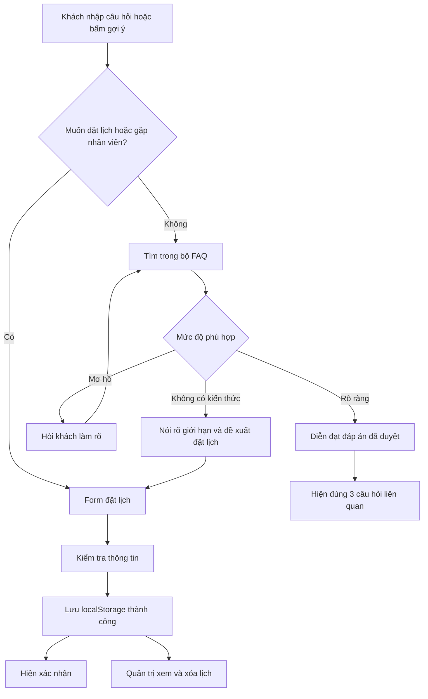

# Quy trình thiết kế chatbot FAQ và đặt lịch tư vấn

Ngày tổng hợp: 03/11/2026.

Chủ đề: hosting/domain. Thương hiệu mẫu: **Hosting Demo** do chưa xác định nhà tài trợ.

Tài liệu này lưu phương án phân tích và thiết kế; chưa phải báo cáo triển khai hoặc kết quả kiểm thử. Giá và chính sách của Hosting Demo đều là dữ liệu giả lập, cần thay bằng thông tin được nhà tài trợ duyệt khi có.

## 1. Mục tiêu và phạm vi đề bài

Xây dựng chatbot giúp doanh nghiệp nhỏ trả lời khách hàng 24/7 và tiếp nhận yêu cầu tư vấn khi bộ kiến thức chưa đủ.

| Yêu cầu | Phương án đáp ứng |
|---|---|
| Trả lời 08–10 FAQ | Sử dụng 10 FAQ do đội biên soạn và duyệt |
| AI diễn đạt tự nhiên | Tách lớp diễn đạt; vòng loại dùng mock có chú thích |
| Gợi ý 03 câu hỏi sau mỗi lượt trả lời | Lấy từ ba FAQ liên quan đã biên tập |
| Không trả lời được | Nói rõ thiếu thông tin và chủ động đề xuất đặt lịch |
| Form đặt lịch | Chọn ngày/giờ, nhập tên và số điện thoại |
| Lưu lịch | localStorage |
| Quản trị | Xem danh sách và xóa lịch đã xử lý, không cần đăng nhập |
| README | Liệt kê 10 FAQ, cách chạy, cách mock AI và giới hạn demo |

Chatbot có thể tiếp nhận câu hỏi và lịch hẹn 24/7; giờ tư vấn của nhân viên được cấu hình riêng.

## 2. Nghiên cứu các mẫu chatbot doanh nghiệp

Các nhận xét dưới đây dựa trên tài liệu chính thức, chưa phải kết quả tự kiểm thử dịch vụ.

| Sản phẩm | Hành vi được mô tả | Bài học áp dụng |
|---|---|---|
| [Intercom Fin](https://www.intercom.com/help/en/articles/7837535-fin-ai-agent-faqs) | Sử dụng nội dung hỗ trợ được cung cấp; chuyển sang đội hỗ trợ khi không giải quyết được | Tách tìm kiến thức, tạo câu trả lời và chuyển tiếp |
| [Tidio Lyro](https://www.tidio.com/ai-agent/trust-and-quality/) | Trả lời từ dữ liệu doanh nghiệp, có quy tắc chuyển người hỗ trợ | Giữ câu trả lời trong phạm vi kiến thức đã duyệt |
| [Hostinger Agent](https://www.hostinger.com/support/1583780-how-to-contact-hostinger-support/) | Trả lời FAQ, hướng dẫn xử lý lỗi, dẫn bài hỗ trợ; chuyên viên có thể tham gia khi cần | Tham khảo trải nghiệm ngành hosting/domain và giữ ngữ cảnh khi chuyển tiếp |
| [Zendesk](https://support.zendesk.com/hc/en-us/articles/4408824482586-Managing-conversation-handoff-and-handback) | Quản lý thời điểm AI bàn giao và nhân viên tiếp nhận | Quản lý trạng thái hội thoại rõ ràng |

Theo [thông báo của Hostinger](https://www.hostinger.com/support/the-new-hostinger-agent-experience/), Kodee đã được tích hợp vào Hostinger Agent.

### Các dạng chatbot và lựa chọn

| Dạng | Điểm mạnh | Điều cần bổ sung cho đề |
|---|---|---|
| Kịch bản và nút bấm | Dễ kiểm soát và dẫn khách chọn nhu cầu | Nhận câu hỏi nhập tự do |
| Tìm câu trả lời trong kho FAQ | Phù hợp dữ liệu nhỏ, kiểm chứng được nội dung | Nhận nhiều cách hỏi, xử lý mơ hồ và ngoài phạm vi |
| FAQ kết hợp quy trình nghiệp vụ | Vừa tư vấn vừa dẫn đến hành động | Tách logic đặt lịch khỏi logic trả lời |

**Lựa chọn: FAQ kết hợp quy trình đặt lịch.** Trong bài thi, việc chuyển sang nhân viên được thể hiện qua đặt lịch, chưa phải live chat với nhân viên trực tuyến.

## 3. Bài học từ GitHub

| Repository | Nội dung tham khảo | Cách áp dụng |
|---|---|---|
| [chatwoot/chatwoot](https://github.com/chatwoot/chatwoot) | Widget chat, Help Center, giao diện hỗ trợ khách hàng | Tách giao diện khách hàng và giao diện quản trị |
| [RasaHQ/rasa](https://github.com/RasaHQ/rasa) | Nhận diện ý định, quản lý hội thoại, fallback | Xử lý câu hỏi rõ, mơ hồ và thiếu kiến thức |
| [botpress/botpress](https://github.com/botpress/botpress) | Integrations, công cụ phát triển và bot mẫu cho Botpress Cloud | Tách hội thoại khỏi hành động nghiệp vụ |

Lưu ý trạng thái tại thời điểm khảo sát:

- README Rasa Open Source ghi Maintenance Mode.
- Repository Botpress hiện tập trung vào công cụ và tích hợp cho Cloud; không nên mặc định đó là toàn bộ nền tảng self-host.
- [Flowise](https://github.com/FlowiseAI/Flowise) đã archive ngày 13/08/2026, nên không được chọn làm nền tảng cho phương án này.

Tham khảo thêm [Rasa: Fallback and Human Handoff](https://legacy-docs-oss.rasa.com/docs/rasa/fallback-handoff/) để học cách hỏi làm rõ và chuyển hỗ trợ.

## 4. Kiến trúc đề xuất

> Cập nhật triển khai 06/11/2026: theo yêu cầu áp dụng Ponytail, bản demo thực tế dùng HTML/CSS/JavaScript thuần, không cần build. Các chức năng vẫn theo quy trình bên dưới; xem README.md để chạy và kiểm thử. React/TypeScript/Vite dưới đây là phương án thiết kế ban đầu.

- Giao diện: React + TypeScript + Vite.
- Bộ kiến thức: dữ liệu JSON/TypeScript gồm 10 FAQ.
- Tìm câu trả lời: đối chiếu câu hỏi, cách hỏi tương đương và cụm từ đặc trưng.
- Diễn đạt: lớp mock độc lập, có thể thay bằng AI thật sau này.
- Đặt lịch: kiểm tra dữ liệu bằng code và lưu qua lớp lưu trữ riêng.
- Quản trị: đọc/xóa từ cùng lớp lưu trữ.
- Phạm vi dữ liệu hiện tại chưa cần vector database.



Trạng thái hội thoại: `chatting`, `clarifying`, `booking`, `saving`, `booking_success`, `booking_error`. Nếu hủy form, quay lại chat và giữ lịch sử. Khi đang nhập form, bot không tự chuyển ngữ cảnh.

## 5. Thiết kế trải nghiệm chat

Desktop dùng trang giới thiệu đơn giản và widget chat ở góc dưới bên phải. Mobile mở chat gần toàn màn hình.

Khung chat gồm:

- Tên “Trợ lý Hosting Demo” và phạm vi hỗ trợ.
- Lời chào, ba câu hỏi khởi đầu, ô nhập và nút gửi.
- Trạng thái đang xử lý; câu trả lời ngắn, dễ đọc.
- Đúng ba câu hỏi liên quan dưới mỗi câu trả lời.
- Nút “Đặt lịch tư vấn” dễ tìm.
- Chú thích “Bản demo sử dụng mô phỏng diễn đạt AI”.

Lời chào mẫu:

> Chào bạn! Mình có thể giải đáp về hosting, tên miền, SSL và các chính sách mẫu của Hosting Demo. Bạn muốn tìm hiểu nội dung nào?

Ba câu hỏi khởi đầu:

1. Hosting và tên miền khác nhau thế nào?
2. Nên chọn gói hosting nào?
3. Hosting có giá bao nhiêu?

Chỉ yêu cầu tên và số điện thoại khi khách quyết định đặt lịch.

## 6. Bộ kiến thức và cơ chế tìm câu trả lời

```ts
type Faq = {
  id: string;
  category: string;
  question: string;
  aliases: string[];
  keywords: string[];
  answer: string;
  answerVariants: string[];
  relatedIds: [string, string, string];
};
```

Ví dụ các cách hỏi tương đương về giá: “Hosting bao nhiêu tiền?”, “Cho mình xin bảng giá”, “host gia sao?”, “Chi phí thuê hosting?”.

Quy trình xử lý:

1. Chuẩn hóa khoảng trắng và chữ hoa/thường; tạo thêm bản không dấu để đối chiếu, giữ nguyên nội dung gốc để hiển thị.
2. Đối chiếu câu hỏi chính, aliases và cụm từ đặc trưng.
3. So sánh kết quả tốt nhất với kết quả thứ hai và kiểm tra đáp án có thực sự bao phủ yêu cầu.
4. Câu rõ: trả lời. Câu mơ hồ: hỏi làm rõ. Thiếu kiến thức: đề xuất đặt lịch.
5. Khi bấm câu gợi ý, truyền trực tiếp `faqId` để lấy đúng đáp án.

Không dùng riêng từ “hosting” để suy ra khách đang hỏi giá. “Hosting có hoàn tiền sau 60 ngày không?” phải chuyển fallback nếu kho kiến thức chưa có chính sách hoàn tiền.

Với “Gia hạn bao nhiêu?”, hỏi lại: “Bạn muốn hỏi giá gia hạn hosting hay tên miền?”. Nếu vẫn không đủ căn cứ, đề xuất tư vấn.

Điều chỉnh ngưỡng tìm kiếm bằng tập câu hỏi thử. Điểm tương đồng tự tính không phải xác suất AI hiểu đúng. Câu hỏi nối tiếp thiếu chủ ngữ chỉ được dùng ngữ cảnh khi rõ ràng; nếu không thì hỏi lại.

## 7. Diễn đạt AI và ba câu hỏi liên quan

### Mock ở vòng loại

Mỗi FAQ có 2–3 biến thể đáp án do đội biên soạn, giữ nguyên giá, điều kiện và chính sách. Chọn biến thể theo lượt để hạn chế lặp.

Đáp án chuẩn:

> Gói Starter có giá mẫu 49.000 đồng/tháng, chưa bao gồm tên miền.

Biến thể:

> Bạn có thể bắt đầu với gói Starter ở mức giá demo 49.000đ/tháng. Chi phí tên miền được tính riêng nhé.

Ghi rõ trong README và giao diện rằng đây là mock. Hiệu ứng đang nhập chỉ là trải nghiệm hiển thị.

### Nâng cấp AI thật

Giữ bộ chọn FAQ; thay lớp diễn đạt bằng API phía server. Mô hình nhận đáp án đã duyệt, không được tự thêm giá, cam kết hoặc chính sách. Nếu API lỗi, trả về đáp án chuẩn. Khóa API nằm phía server.

### Câu hỏi liên quan

Mỗi FAQ khai báo đúng ba `relatedIds`, không trùng nhau và không trùng chính nó. Các ID phải tồn tại trong bộ kiến thức.

Ví dụ sau FAQ giá: gợi ý chọn gói, nâng cấp và gia hạn. Khi fallback, vẫn đưa ba FAQ phổ biến có thể trả lời; nút đặt lịch là hành động riêng, không tính trong ba câu hỏi.

## 8. Bộ 10 FAQ mẫu để đưa vào README

**Mọi mức giá và chính sách thương mại trong bảng là giả lập của Hosting Demo.**

| ID | Câu hỏi | Đáp án chuẩn mẫu | Ba FAQ liên quan |
|---|---|---|---|
| F01 | Hosting và tên miền khác nhau thế nào? | Tên miền là địa chỉ để người dùng truy cập website. Hosting cung cấp tài nguyên để lưu trữ và vận hành website. Hai dịch vụ có thể mua cùng hoặc khác nhà cung cấp. | F02, F04, F05 |
| F02 | Tôi nên chọn gói hosting nào? | Trong danh mục demo, Starter dành cho website giới thiệu hoặc blog cơ bản; Business dành cho nhu cầu nhiều tài nguyên hơn. Với website bán hàng hoặc yêu cầu tải cụ thể, bạn nên đặt lịch để được tư vấn cấu hình. | F03, F08, F10 |
| F03 | Hosting có giá bao nhiêu? | Giá giả lập: Starter 49.000đ/tháng, Business 99.000đ/tháng. Đây là giá minh họa cho bài thi, chưa bao gồm tên miền. | F02, F08, F09 |
| F04 | Đã mua tên miền ở nơi khác thì có dùng hosting được không? | Có. Bạn có thể giữ tên miền tại nhà cung cấp hiện tại và cấu hình DNS để kết nối đến hosting. Kết nối tên miền khác với chuyển nhà đăng ký tên miền. | F01, F05, F06 |
| F05 | SSL là gì và có được hỗ trợ không? | SSL/TLS giúp mã hóa kết nối giữa trình duyệt và website qua HTTPS. Theo chính sách demo, cả hai gói hosting hỗ trợ SSL miễn phí sau khi tên miền được cấu hình hợp lệ. | F04, F02, F10 |
| F06 | Có hỗ trợ chuyển website từ nơi khác không? | Theo chính sách demo, đội kỹ thuật tiếp nhận yêu cầu chuyển website và kiểm tra khả năng tương thích trước khi thực hiện. Bạn có thể đặt lịch để trao đổi về nền tảng và dữ liệu cần chuyển. | F04, F07, F10 |
| F07 | Website có được sao lưu không? | Theo chính sách demo, Starter được sao lưu hằng tuần; Business được sao lưu hằng ngày. Việc khôi phục phụ thuộc bản sao lưu còn khả dụng. | F02, F08, F10 |
| F08 | Có thể nâng cấp hosting sau khi mua không? | Theo chính sách demo, bạn có thể yêu cầu nâng từ Starter lên Business. Nhân viên xác nhận chi phí chênh lệch và thời điểm thực hiện trước khi nâng cấp. | F02, F03, F07 |
| F09 | Gia hạn hosting như thế nào? | Trong kịch bản demo, khách liên hệ bộ phận hỗ trợ trước ngày hết hạn để xác nhận thời hạn và phí gia hạn. Ứng dụng này chưa có thanh toán hoặc gia hạn tự động. | F03, F08, F10 |
| F10 | Làm sao đặt lịch tư vấn với nhân viên? | Bấm “Đặt lịch tư vấn”, chọn ngày giờ, nhập họ tên và số điện thoại. Bản demo lưu lịch trên trình duyệt hiện tại; nhân viên có thể xem ở trang quản trị trên cùng trình duyệt. | F02, F03, F06 |

Đối chiếu kiến thức kỹ thuật với [WordPress.com về kết nối và chuyển tên miền](https://wordpress.com/support/domain-connection-vs-domain-transfer/) và [Cloudflare về SSL/TLS](https://www.cloudflare.com/learning/ssl/what-is-ssl/). SSL/TLS bảo vệ kết nối truyền dữ liệu, không có nghĩa website được bảo vệ khỏi mọi loại tấn công.

## 9. Fallback và đề xuất tư vấn

Câu hỏi ngoài phạm vi mẫu:

> Website của tôi có 50.000 người truy cập đồng thời thì cần cấu hình gì?

Phản hồi:

> Mình chưa có đủ thông tin trong bộ kiến thức để tư vấn cấu hình cho mức tải này. Bạn có thể đặt lịch để nhân viên trao đổi thêm về website và nhu cầu sử dụng.

Hiển thị nút **Đặt lịch tư vấn** và ba FAQ có thể hỗ trợ thêm. Không thông báo “Đang kết nối nhân viên” vì demo chưa có live chat. Khách chủ động yêu cầu gặp nhân viên thì mở đặt lịch ngay.

## 10. Form đặt lịch

| Thành phần | Quy tắc đề xuất |
|---|---|
| Ngày | Chọn ngày tương lai; hôm nay chỉ có thể chọn giờ chưa qua |
| Giờ | Khung giờ mẫu 09:00–17:00, mỗi lịch 30 phút; chỉ tạo slot kết thúc trong giờ làm việc |
| Múi giờ | Hiển thị giờ Việt Nam, UTC+7 |
| Họ tên | Bắt buộc; bỏ khoảng trắng thừa, cho phép tên có dấu |
| Điện thoại | Lưu dạng chuỗi, chuẩn hóa và kiểm tra theo phạm vi số điện thoại công bố |
| Nội dung tư vấn | Tự điền câu hỏi chưa giải quyết, cho phép sửa |
| Gửi form | Ngăn gửi lặp; báo lỗi cụ thể khi dữ liệu hoặc lưu trữ thất bại |

```ts
type Appointment = {
  id: string;
  customerName: string;
  phone: string;
  startsAt: string; // ISO 8601, có offset +07:00
  timeZone: "Asia/Ho_Chi_Minh";
  consultationTopic: string;
  sourceFaqId?: string;
  createdAt: string;
};
```

Chỉ báo thành công sau khi ghi localStorage thành công. Có thể kiểm tra trùng khung giờ trong dữ liệu cục bộ để demo; đây chưa phải cơ chế chống trùng lịch giữa nhiều khách hàng.

Thông báo mẫu:

> Đã lưu lịch tư vấn trong bản demo: 09:30 ngày …, giờ Việt Nam. Bạn có thể xem lịch này tại trang quản trị trên trình duyệt hiện tại.

## 11. Lưu trữ và trang quản trị

Trang quản trị không cần đăng nhập theo đề. Hiển thị thời gian hẹn, họ tên, điện thoại, nội dung và nút “Xóa lịch đã xử lý”. Sắp xếp theo ngày hẹn, có trạng thái danh sách trống và xác nhận trước khi xóa.

Chat và quản trị dùng chung lớp lưu trữ:

- `listAppointments()`
- `createAppointment(input)`
- `deleteAppointment(id)`

Dùng một khóa có phiên bản, ví dụ `hosting-demo.appointments.v1`. Kiểm tra cấu trúc dữ liệu khi đọc, xử lý JSON hỏng và lỗi ghi; không báo thành công giả hoặc âm thầm ghi đè dữ liệu lỗi. Thêm/xóa bằng danh sách mới để tuân thủ nguyên tắc bất biến.

Theo [MDN: localStorage](https://developer.mozilla.org/en-US/docs/Web/API/Window/localStorage), dữ liệu lưu theo origin và tồn tại qua các phiên trình duyệt. Demo chat và quản trị phải chạy trên cùng origin, cùng hồ sơ trình duyệt. Nên chạy bằng web server phát triển thay vì mở file HTML trực tiếp.

**Giới hạn cần ghi rõ:** lịch đặt trên điện thoại của khách không tự xuất hiện trên máy tính của nhân viên. Bản này mô phỏng quy trình bằng dữ liệu cục bộ. Khi triển khai thật, cần API/database dùng chung, quyền truy cập quản trị và cơ chế quản lý lịch tập trung.

## 12. Kế hoạch triển khai và kiểm thử

| Thứ tự | Công việc | Điều kiện hoàn thành |
|---|---|---|
| 1 | Soạn 10 FAQ, aliases, biến thể và câu liên quan | Nội dung nhất quán, mọi ID hợp lệ |
| 2 | Viết kiểm thử rồi xây bộ tìm FAQ | Xử lý câu rõ, không dấu, mơ hồ và ngoài phạm vi |
| 3 | Làm giao diện chat và mock diễn đạt | Đúng đáp án, đúng ba gợi ý, có chú thích mock |
| 4 | Làm fallback, form và localStorage | Lưu hợp lệ, báo lỗi đúng, tải lại vẫn còn lịch |
| 5 | Làm quản trị | Xem được lịch vừa tạo, xóa đúng lịch và lưu thay đổi |
| 6 | Kiểm thử toàn luồng và hoàn thiện README | Demo chạy trọn vẹn trên desktop và mobile |

Áp dụng TDD cho phần nghiệp vụ: viết kiểm thử thất bại trước, triển khai tối thiểu để vượt qua, rồi cải thiện cấu trúc. Mục tiêu coverage tối thiểu 80% theo hướng dẫn dự án; chỉ báo đạt sau khi đo thực tế.

| Cấp kiểm thử | Nội dung |
|---|---|
| Unit | Chuẩn hóa tiếng Việt, tìm FAQ, phát hiện mơ hồ, chọn gợi ý, kiểm tra form |
| Integration | Chat chọn đúng FAQ; form lưu và quản trị đọc cùng dữ liệu; xử lý lỗi lưu trữ |
| E2E | Hỏi FAQ → hỏi ngoài phạm vi → đặt lịch → mở quản trị → xóa → tải lại |

Các trường hợp quan trọng:

- Mỗi FAQ được hỏi bằng nhiều cách, gồm câu có dấu và không dấu.
- Dùng thêm câu hỏi thử không có nguyên văn trong aliases.
- Câu chứa từ khóa đúng chủ đề nhưng đòi hỏi chính sách chưa có phải fallback.
- Câu mơ hồ phải hỏi làm rõ thay vì chọn tùy tiện.
- Mỗi phản hồi có đúng ba câu hỏi gợi ý hợp lệ, không trùng nhau.
- Mock diễn đạt không đổi giá hoặc điều kiện.
- Không chấp nhận lịch quá khứ, tên rỗng hoặc điện thoại sai định dạng đã chọn.
- Lỗi ghi storage không tạo thông báo thành công.
- Xóa một lịch không làm mất các lịch khác; tải lại vẫn giữ thay đổi.
- Tên và nội dung do người dùng nhập được hiển thị như văn bản, không thực thi HTML.

## 13. Nội dung README và kịch bản demo

README cần có: giới thiệu bài toán; hướng dẫn cài/chạy; 10 FAQ và đáp án; cơ chế tìm kiếm; cách mock AI; quy tắc gợi ý; luồng fallback; cách lưu/xóa lịch; chính sách giả lập; giới hạn localStorage; hướng dẫn kiểm thử và các nguồn tham khảo.

Kịch bản trình bày:

1. Mở chat và hỏi “host gia sao?” để minh họa câu không dấu.
2. Kiểm tra đáp án giá và ba câu liên quan.
3. Hỏi câu mơ hồ để bot yêu cầu làm rõ.
4. Hỏi cấu hình cho 50.000 người truy cập đồng thời để kích hoạt fallback.
5. Bấm đặt lịch, thử dữ liệu sai rồi nhập thông tin hợp lệ.
6. Xác nhận chỉ thông báo thành công sau khi lưu.
7. Mở trang quản trị trong cùng trình duyệt/origin để xem lịch.
8. Xóa lịch đã xử lý và tải lại để kiểm tra dữ liệu đã cập nhật.

Không cần mở rộng CRM, thanh toán hoặc AI tự thao tác tài khoản để hoàn thành phạm vi bài này. Ưu tiên chất lượng FAQ, cách nhận biết giới hạn và luồng đặt lịch hoàn chỉnh.
